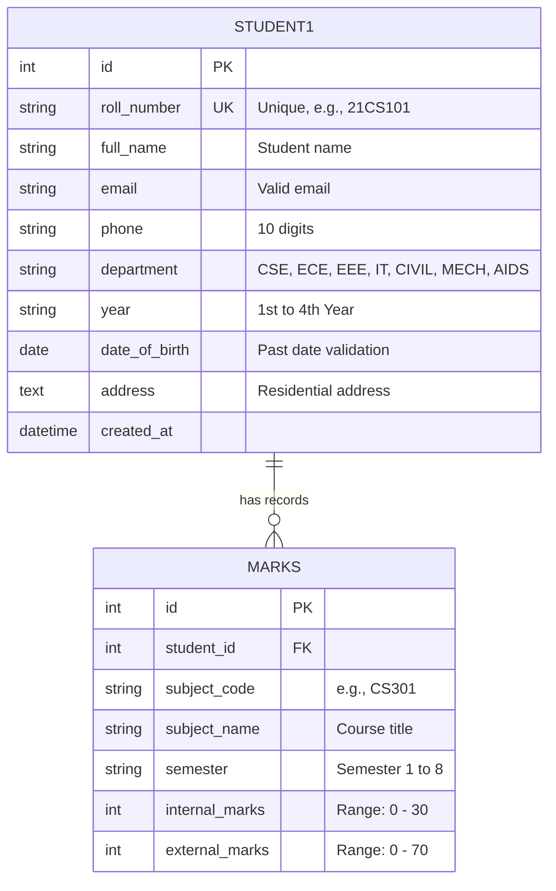

# 🎓 College Student & Marks Management System

[](https://www.python.org/)
[](https://www.djangoproject.com/)
[](https://www.sqlite.org/)
[](LICENSE)
[](https://github.com/Anwar102006/Student_Managment_System)

A full-stack, responsive **Student Management and Examination Marks Processing Web Application** built with **Django**, **SQLite**, and modern web standards. Designed for college academic offices to streamline student enrollments, departmental records, internal/external marks calculations, grading, and performance tracking.

---

## 📌 Table of Contents
- [✨ Key Features](#-key-features)
- [🖥️ UI & Dashboard Highlights](#️-ui--dashboard-highlights)
- [🏗️ System Architecture & Data Models](#️-system-architecture--data-models)
- [🛠️ Tech Stack](#️-tech-stack)
- [📁 Project Structure](#-project-structure)
- [🚀 Quick Start & Installation](#-quick-start--installation)
- [🔐 Admin Panel](#-admin-panel)
- [📋 Form Validations & Business Logic](#-form-validations--business-logic)
- [🤝 Contributing](#-contributing)
- [📄 License](#-license)

---

## ✨ Key Features

### 👨‍🎓 1. Student Records Management
- **Full Student Profile:** Capture Roll Number, Full Name, Email, 10-digit Phone, Department, Academic Year, Date of Birth, and Residential Address.
- **Strict Data Integrity:** Built-in uniqueness checks for roll numbers and format validation for emails and phone numbers.
- **Dynamic Search Filter:** Instant search query support across Roll Number, Full Name, Email, and Department.

### 📝 2. Examination & Marks Evaluation
- **Coursework & Exam Split:** Enter internal marks (up to 30) and semester external marks (up to 70).
- **Automated Grade & Result Engine:**
  - Total percentage calculation out of 100.
  - Grade computation: **A+** (≥90), **A** (≥80), **B** (≥70), **C** (≥60), **D** (≥50), **E** (≥40), and **F** (<40).
  - Status classification: **Pass** (minimum 12 in internal and ≥40 overall) vs. **Fail**.
- **Duplicate Prevention:** Prevents duplicate mark entries for the same student, subject code, and semester via database constraints.
- **Client-Side Live Preview:** Real-time total calculation preview on input change before form submission.

### 📊 3. Modern Interactive Dashboard
- Single-page navigation with tab switching: **Dashboard Overview**, **Student Registration**, and **Marks Management**.
- Real-time stat summary cards showing Total Enrolled Students, Total Examination Records, and Active Departments.
- Responsive design tailored for desktops, tablets, and mobile devices.

---

## 🖥️ UI & Dashboard Highlights

| Screen | Description |
|---|---|
| **🏠 College Dashboard** | Displays metric counters, recent examination records, and a quick student overview table with direct navigation buttons. |
| **👨‍🎓 Student Registration** | Clean 3-column responsive form with validation feedback, alongside a searchable list of all enrolled students. |
| **📝 Marks Management** | Real-time marks preview calculator, dynamic student selector, and comprehensive marks ledger with auto-generated grades and results. |
| **⚙️ Django Admin** | Administrative backend with tabular inline marks management, list filters, and advanced search capability. |

---

## 🏗️ System Architecture & Data Models



---

## 🛠️ Tech Stack

- **Backend:** [Python 3.10+](https://www.python.org/) & [Django 6.1+](https://www.djangoproject.com/)
- **Database:** [SQLite3](https://www.sqlite.org/) (configurable for PostgreSQL/MySQL via `settings.py`)
- **Frontend:** Semantic HTML5, Vanilla CSS3 (custom flexbox/grid design system with dark navy theme), Vanilla JavaScript
- **Architecture:** Django MVT (Model-View-Template) pattern

---

## 📁 Project Structure

```text
Student_Managment_System/
│
├── myproject/
│   ├── manage.py                     # Django CLI management script
│   ├── db.sqlite3                    # SQLite database file
│   │
│   ├── myproject/                    # Root configuration package
│   │   ├── __init__.py
│   │   ├── asgi.py
│   │   ├── wsgi.py
│   │   ├── settings.py               # Installed apps, templates, database setup
│   │   └── urls.py                   # Root URL dispatcher
│   │
│   └── student_mngmnt_sysytem/       # Core application
│       ├── admin.py                  # Customized Django Admin interfaces
│       ├── apps.py                   # App configuration
│       ├── forms.py                  # ModelForms & custom validators
│       ├── models.py                 # Student1 and Marks models + properties
│       ├── urls.py                   # Application routing (dashboard, students, marks)
│       ├── views.py                  # Dashboard, add_student, and add_marks controllers
│       ├── migrations/               # Database migration scripts
│       └── templates/
│           └── index.html            # Main responsive dashboard template
│
├── .gitignore                        # Git ignore patterns
└── README.md                         # Project documentation
```

---

## 🚀 Quick Start & Installation

### 1. Clone the Repository
```bash
git clone https://github.com/Anwar102006/Student_Managment_System.git
cd Student_Managment_System
```

### 2. Set Up a Python Virtual Environment

**On Windows (PowerShell):**
```powershell
python -m venv .venv
.\.venv\Scripts\Activate.ps1
```

**On macOS / Linux:**
```bash
python3 -m venv .venv
source .venv/bin/activate
```

### 3. Install Dependencies
```bash
pip install django
```

### 4. Run Database Migrations
```bash
cd myproject
python manage.py migrate
```

### 5. Create an Admin Account (Optional)
```bash
python manage.py createsuperuser
```

### 6. Start the Development Server
```bash
python manage.py runserver
```

Open your browser and navigate to:
- 🌐 **Dashboard:** [http://127.0.0.1:8000/](http://127.0.0.1:8000/)
- ⚙️ **Admin Panel:** [http://127.0.0.1:8000/admin/](http://127.0.0.1:8000/admin/)

---

## 🔐 Admin Panel

The project comes with a feature-rich administrative dashboard:
- **Student Management:** View and search by roll number, name, or email; filter by department and academic year.
- **Inline Marks:** View and add marks directly from within any student's detail page via `TabularInline`.
- **Custom Computed Columns:** Displays computed **Total**, **Grade**, and **Result** columns automatically in the records list.

---

## 📋 Form Validations & Business Logic

| Field / Action | Rule / Logic |
|---|---|
| **Roll Number** | Converted to uppercase; alphanumeric with hyphens/underscores; guaranteed unique in DB. |
| **Phone** | Exactly 10 numeric digits validated using regular expressions (`^[0-9]{10}$`). |
| **Date of Birth** | Validated to ensure the date is strictly in the past. |
| **Internal Marks** | Integer bounded between `0` and `30`. |
| **External Marks** | Integer bounded between `0` and `70`. |
| **Unique Marks Record** | `UniqueConstraint(student, subject_code, semester)` prevents duplicate student grades per subject per semester. |

---

## 🤝 Contributing

Contributions, issues, and feature requests are welcome!
1. Fork the Project
2. Create your Feature Branch (`git checkout -b feature/AmazingFeature`)
3. Commit your Changes (`git commit -m 'Add some AmazingFeature'`)
4. Push to the Branch (`git push origin feature/AmazingFeature`)
5. Open a Pull Request

---

## 📄 License

Distributed under the **MIT License**. See `LICENSE` for more information.

---

<p align="center">
  Developed by <a href="https://github.com/Anwar102006"><b>Anwar Shaik</b></a>
</p>